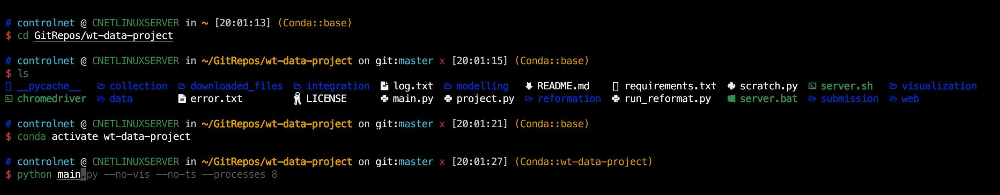

# envira
A script to fast build my zsh theme environment

It supports the following distributions:
- Ubuntu and Mint
- Redhat, CentOS, ...
- Manjaro

What tools will be installed:
- The basic development tools (vim, wget, git, ...)
- Install zsh as the default shell
- A theme (modified mzz-ys) for zsh with oh-my-zsh
- Frequently used languages and package managers (python with conda, nodejs, rust, golang, ...)
- Modern linux terminal tools (exa, bat, fd, ripgrep, lazygit, lunarvim, ...) with alias



## How to use it

### envira (new)

`envira` is a single binary for Linux (x86_64 and aarch64, static, no dependencies) and Apple Silicon
Macs. It knows the tools and configs from a catalog, shows what is installed, and installs, updates
or reverts them.

```shell
# install into ~/.local/bin (checks its SHA-256) and open envira
curl -fsSL https://boot.controlnet.space/envira | bash
# install and run a command instead, e.g. in a Dockerfile or CI (no terminal needed)
curl -fsSL https://boot.controlnet.space/envira | bash -s -- sync -b full -y
# or from PyPI
pipx install envira        # or: uv tool install envira
```

```shell
envira                     # the TUI: pick bundles, review the plan, watch it run
envira status              # what is installed, missing, outdated or drifted
envira plan                # what `envira sync` would do, without doing it
envira sync -y             # install everything the selected bundles need
envira install bat yazi    # some tools (or bundles), with their dependencies
envira update              # update outdated tools in place
envira retry               # retry what failed or was blocked in the last run
envira log / explain <id>  # logs of the last run; why an item has its status
envira doctor              # machine facts, catalog layers, PATH, shell integration
```

- With sudo, packages go system-wide; without it, envira picks user-scope routes
  (`--scope user` forces that).
- macOS: install [Homebrew](https://brew.sh) first; envira uses it for most tools and does not
  install it itself. Without it, only tools with another route (cargo, pipx, npm, vendor scripts)
  are available. Linux-only items (Docker, the default-shell and sysctl configs) show as n/a.
  Intel Macs are not supported yet.
- envira uses the catalog published at `boot.controlnet.space/envira/catalog.toml`, so new tools
  arrive without a new release. It is cached for an hour, and it falls back to the cache and
  then to the catalog built into the binary. `--no-remote` uses only the built-in one.
- Your own items go in `~/.config/envira/catalog.d/*.toml`. `envira catalog schema` prints the
  format, and `envira catalog check` validates it.
- Variables for the install script: `ENVIRA_VERSION=v0.2.0` pins a release,
  `ENVIRA_INSTALL_DIR` changes where it puts the binary, and `ENVIRA_NO_LAUNCH=1` only installs.

### Legacy scripts

```shell
curl -fsSL https://boot.controlnet.space/ | bash        # if you have sudo permission
curl -fsSL https://boot.controlnet.space/user | bash    # if you don't have sudo permission
curl -fsSL https://boot.controlnet.space/verify | bash  # verify the installation
```

### For docker

Full tools and configurations for the environment:
```dockerfile
FROM ubuntu:22.04

WORKDIR /root

RUN apt-get update -y
RUN DEBIAN_FRONTEND=noninteractive TZ=Etc/UTC apt-get install -o DPkg::Options::="--force-confnew" -y tzdata
RUN DEBIAN_FRONTEND=noninteractive apt-get install -y iputils-ping net-tools python3-venv apt-utils make openssh-server gedit vim git git-lfs curl wget zsh gcc make perl build-essential libfuse2 python3-pip screen fzf tmux ncdu bat pipx xsel screenfetch neofetch p7zip-full unzip tigervnc-standalone-server tigervnc-common tigervnc-xorg-extension

RUN curl -fsSL https://boot.controlnet.space/user | bash

CMD ["/bin/zsh"]
```

Minimal oh-my-zsh setup without extra tools:
```dockerfile
# Setup environment
RUN sh -c "$(wget -O- https://github.com/deluan/zsh-in-docker/releases/download/v1.1.5/zsh-in-docker.sh)" -- \
    -t robbyrussell \
    -p https://github.com/zsh-users/zsh-autosuggestions \
    -p https://github.com/zsh-users/zsh-syntax-highlighting

# download theme
RUN curl -fsSL https://raw.githubusercontent.com/ControlNet/my-zsh-theme-env/main/files/mzz-ys.zsh-theme > /root/.oh-my-zsh/themes/mzz-ys.zsh-theme

# modify the .zshrc file to change the theme and add plugins
RUN cat /root/.zshrc | sed 's/ZSH_THEME=\"robbyrussell\"/ZSH_THEME=\"mzz-ys\"\nZSH_DISABLE_COMPFIX=\"true\"/' \
    | sed 's/plugins=(git)/plugins=(git zsh-autosuggestions zsh-syntax-highlighting)/' > /root/temp.zshrc
RUN mv /root/temp.zshrc /root/.zshrc

# setup git alias
RUN git config --global alias.lsd "log --graph --decorate --pretty=oneline --abbrev-commit --all"

# hide conda prefix
RUN echo "changeps1: false" >> /root/.condarc
```

### Detail Steps

1. Checks the Linux distribution and installs a set of common development tools using the appropriate package manager.
2. Installs pipx, a tool for installing and running Python applications in isolated environments.
3. Downloads and installs bat, a cat clone with syntax highlighting and Git integration.
4. Installs Node.js using nvm (Node Version Manager).
5. Downloads and installs ctop, a top-like interface for container metrics.
6. Installs neofetch, a command-line system information tool.
7. Sets up tmux with a specific color scheme.
8. Installs oh-my-zsh, a framework for managing Zsh configuration.
9. Changes the default shell to Zsh.
10. Downloads a specific Zsh theme and modifies the .zshrc file to use this theme and add plugins.
11. Disables oh-my-zsh auto-update notifications.
12. Installs additional Zsh plugins for autosuggestions and syntax highlighting.
13. Sets up Git history visualization and credential storage.
14. Installs Miniconda, a free minimal installer for conda.
15. Sets up the Rust programming language and Go programming language environments.
16. Installs lazygit, a simple terminal UI for git commands.
17. Installs neovim, a highly configurable text editor.
18. Sets up LunarVim, a distribution of Neovim.
19. Installs a faster solver for conda.
20. Installs the Meslo font.
21. Installs Docker and sets up the user to run Docker commands without sudo.
22. Installs lazydocker, a simple terminal UI for Docker.
23. Installs lemonade, a remote operation utility.
24. Installs ZeroTier, a global P2P VPN.
25. Installs several utilities (lsd, git-delta, duf, dust, fd, ripgrep, gping, procs, xh, uv, speedtest-cli, gdown, zoxide, micro, scc, viu, pm2) and sets up aliases for some of them.
26. Installs several system monitoring tools (bottom, nvitop, bpytop, bandwhich).

### Long install tip (keep sudo alive)

If your sudo credential times out during a long installation, `run.sh` now automatically refreshes sudo credentials in the background after the first sudo prompt.


## License

AGPL 3.0 - see [LICENSE](LICENSE) file for details.
